<div align="center">

# Claude Deck

**Run many Claude Code sessions side by side in one window, organised in folders, searchable, and resumable after a reboot, with animated pixel wallpapers behind them.**

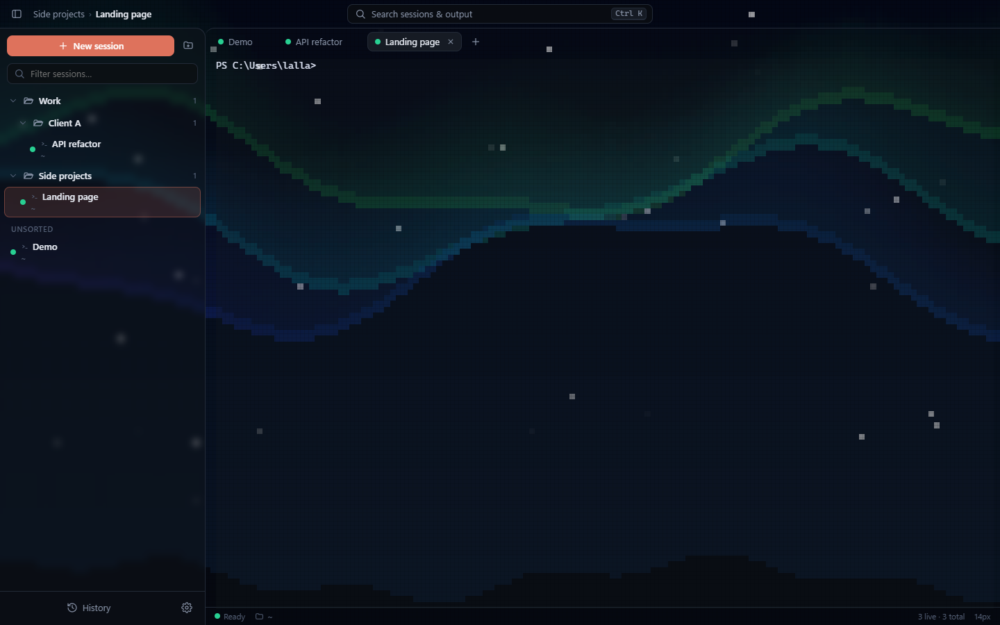

[Watch the 30 second explainer](docs/explainer.mp4) · Windows 10/11 · MIT license

</div>

## Why

Claude Code lives in a terminal, so ten projects means ten terminal windows and no memory of which was which. Claude Deck is a real terminal manager built for that:

- **Real terminals.** xterm.js on ConPTY, so Claude Code behaves exactly as it does in Windows Terminal.
- **Folders and search.** Nested folders, drag and drop, colour tags, and a Ctrl K search over session names *and* terminal output.
- **Reboot-proof.** Each tab owns a Claude session id. After a restart, one click runs `claude --resume` on every tab that was open.
- **Remote control.** Drive every session from one Telegram chat.
- **Animated wallpapers.** Pixel-art backgrounds behind your terminals (below).

## Animated wallpapers

Settings → *Animated wallpaper*. Seven wallpapers are drawn live in code on a tiny 192×108 canvas and scaled up with hard pixels. Three more are short AI-generated loops. A circular wipe from the bottom-left corner reveals the new wallpaper when you switch.

| | | |
|:--:|:--:|:--:|
| 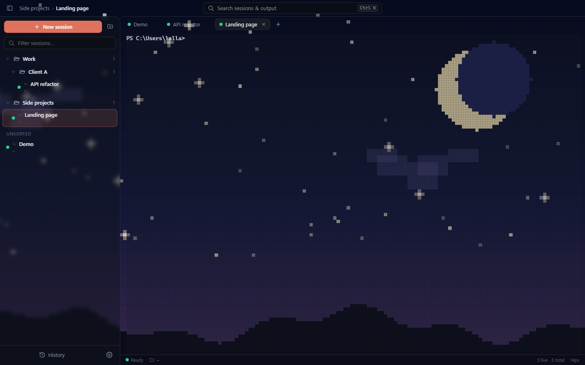 **Moonlit** | 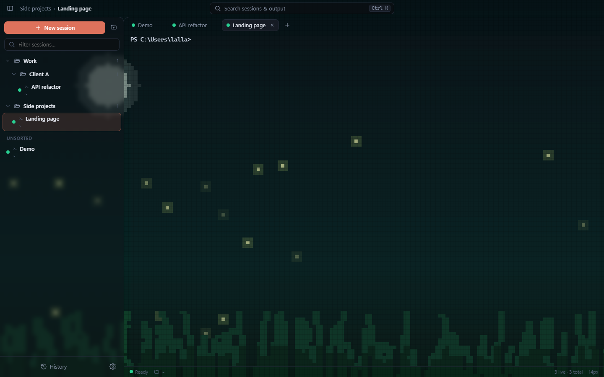 **Fireflies** | 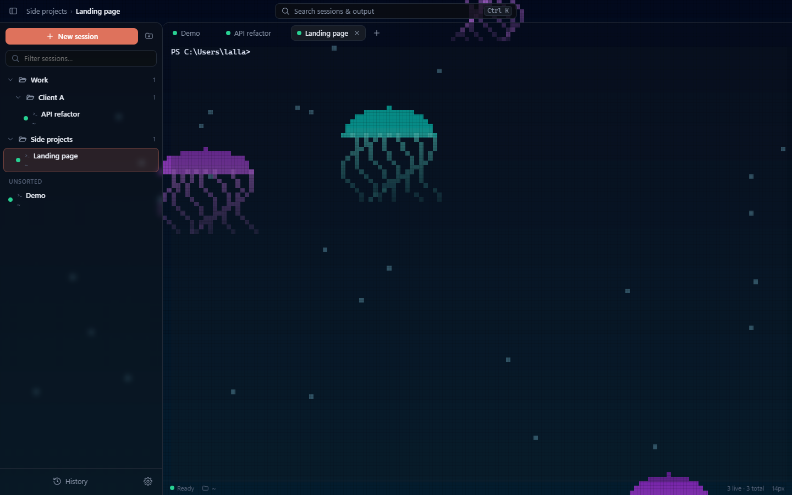 **Jellyfish** |
| 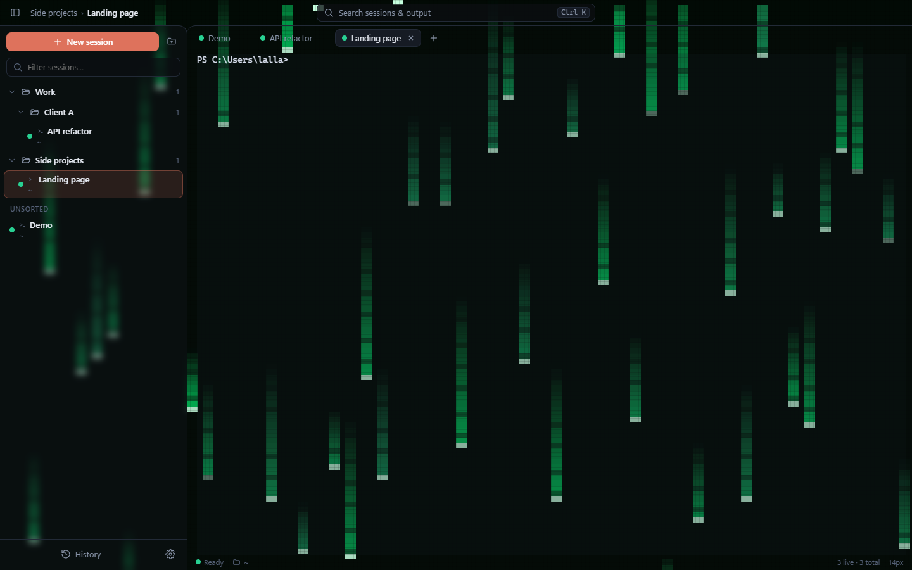 **Code rain** | 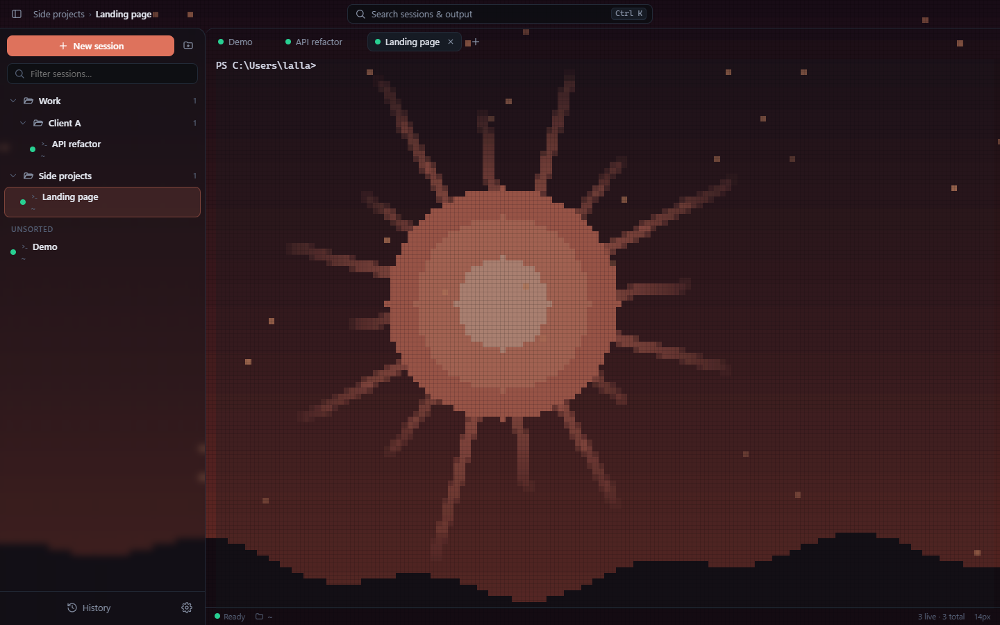 **Claude Sun** | 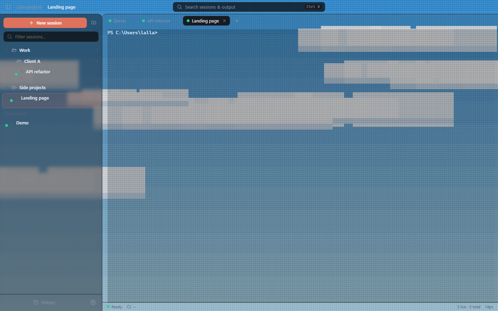 **Cloud drift** |
| 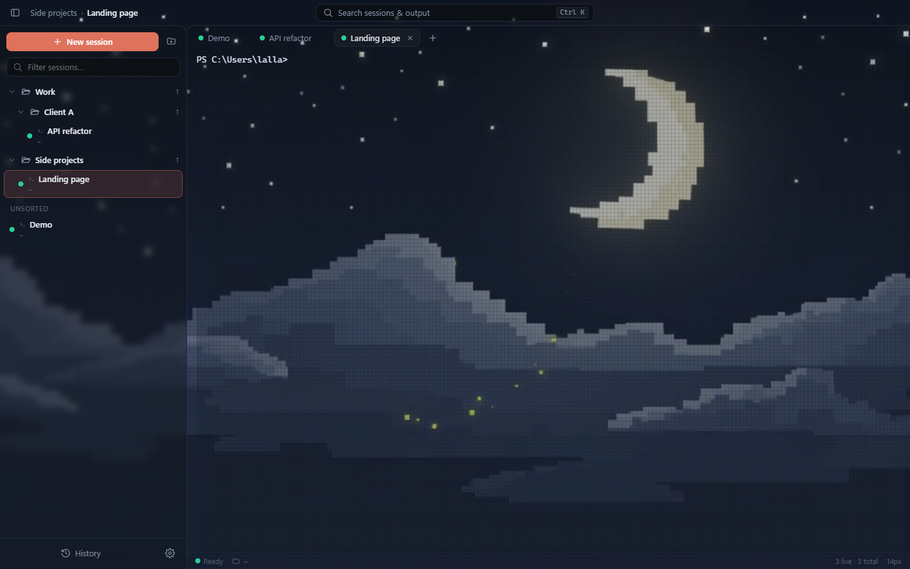 **Moon Night (AI)** | 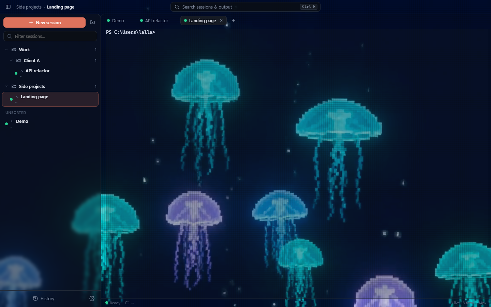 **Deep Sea (AI)** | 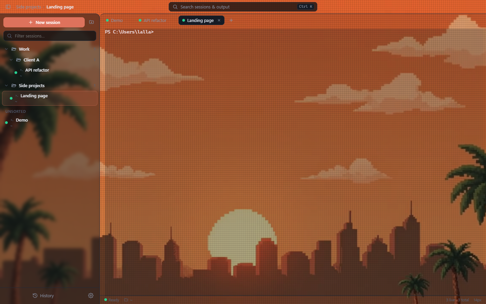 **Retro Sunset (AI)** |

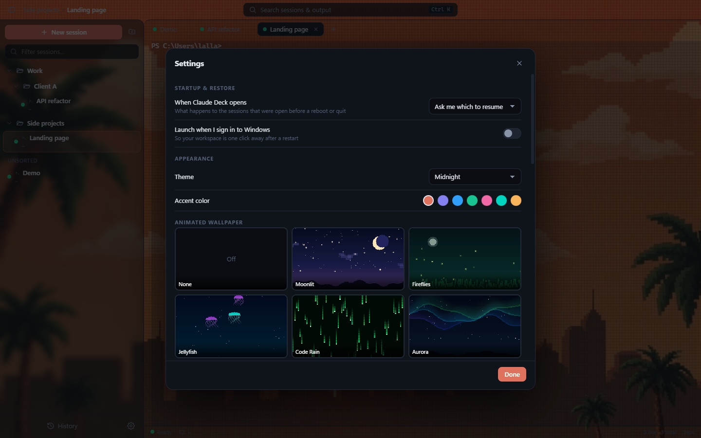

**How they work**

- *Code themes* live in [`src/bgfx.js`](src/bgfx.js). Each one is a small `init()` plus `draw(ctx, t, state)` function, with a faint grid overlay for the LED look. Adding a theme means adding one object.
- *AI themes* were generated with Kling 3.0 Turbo from a text prompt (about 7 credits each), then made seamless with ffmpeg by playing the clip forward and then reversed. They are plain mp4 files in [`src/themes-ai/`](src/themes-ai), so you can drop in your own and register it in the `AI` table.
- Panels turn translucent over a wallpaper. The **Readability scrim** slider sets how strongly they cover it, and animation pauses while the window is in the background.

## Run
```
npm install          # once
npm start            # or double-click the "Claude Deck" shortcut (powershell -File install-shortcut.ps1)
```

## How restore works
Each Claude tab owns a session UUID. New tabs start with `claude --session-id <uuid>`; waking a tab runs `claude --resume <uuid>`, so you get the exact conversation back (Claude Code stores it under `~/.claude/projects`). The app tracks which tabs were open and saves state atomically on every change (`%APPDATA%\ClaudeDeck\state.json`, with a `.bak`), so even a hard power-off keeps your layout. On launch you get a "Welcome back" dialog (or auto-resume / do nothing — Settings → Startup).

Tip: enable **Launch when I sign in to Windows** in Settings and your workspace greets you after every restart.

## Shortcuts
| Key | Action |
|---|---|
| Ctrl T / Ctrl W | New session / put current to sleep |
| Ctrl K | Search sessions **and terminal output** + actions |
| Ctrl B | Toggle sidebar |
| Ctrl Tab, Ctrl 1-9 | Switch live tabs |
| Ctrl Shift T | Reopen last removed session |
| Ctrl Shift N | New folder |
| Ctrl F | Find in terminal |
| Ctrl H | Browse / import past Claude sessions |
| Ctrl + / − / 0, Ctrl+scroll | Zoom |
| Ctrl C (with selection) / Ctrl V / right-click | Copy / paste (plain Ctrl C still interrupts) |
| F2 | Rename |

## Features
- Nested folders (drag & drop sessions and folders, reorder, colour tags, pins)
- Sleep vs remove: sleeping frees the process but keeps the conversation resumable
- Live status dots: working / ready / **finished while you were away** (+ desktop notification & taskbar flash)
- Claude's own session title shown under each tab name
- History browser: import any past Claude conversation as a tab
- Drag files into a terminal to paste their paths
- 4 colour themes, 7 accents, 10 animated wallpapers, WebGL rendering for the visible tab

## Telegram remote control
Control every session from one Telegram chat. Settings → *Telegram remote control*: paste the bot token (from @BotFather), switch it on, press **Generate pairing link**, open it in Telegram and press Start. After that only your account is accepted; everyone else is ignored silently. The token is stored encrypted with Windows DPAPI, and messages that piled up while the app was off are discarded rather than run.

| Command | What it does |
|---|---|
| `/list` | All sessions, numbered, grouped by folder, with status |
| `@3 message` / `/to 3 message` | Send a message to session 3 (number or part of the name) — it wakes a sleeping session first |
| `/use 3` | Default target; plain text then goes to it |
| `/peek 3 [lines]` | Current screen of a session |
| `/key 3 down enter` · `/key 3 1` | Press keys (answer permission prompts, menus) |
| `/stop 3` | Esc / interrupt |
| `/wake 3` · `/sleep 3 [force]` | Resume / sleep |
| `/new C:\path [title]` | Start a new Claude session |
| `/notify on` | Ping when *any* session finishes (sessions you message always reply) |

Keep in mind: a tab started with `--dangerously-skip-permissions` will act on whatever you send it, so treat the paired Telegram account like a keyboard on your PC.

Smoke test (dev): `set CT_SMOKE=1&& npx electron .` writes screenshots to `%TEMP%\claudedeck-smoke`.


## Build an installer
`npm run dist` (electron-builder, NSIS) writes `dist\Claude Deck Setup <version>.exe`.

## License
MIT
